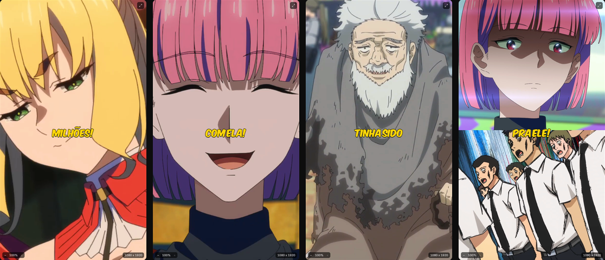
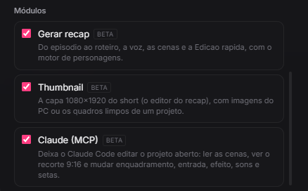
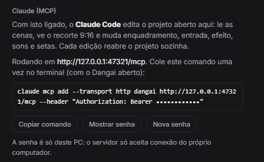
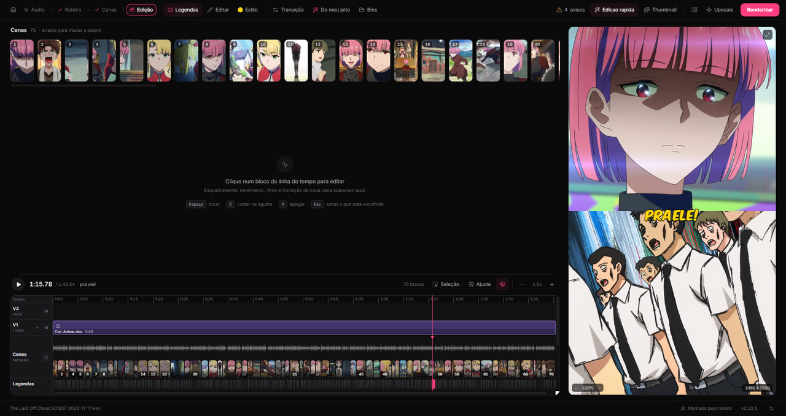
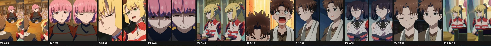

# 🎬 dangai-edicao

**Skill do Claude Code que edita shorts de recap de anime no [Dangai](https://github.com/faahpla/dangai) por você.**
Você manda o episódio, o roteiro e o áudio; o Claude escolhe as cenas, centraliza no rosto, confere tudo no vertical e entrega o projeto pronto pra renderizar.



## O que ela faz

- 🎯 **Escolhe uma cena por palavra de peso**: gancho com 2–3 cenas, ~1,3 s por cena, sem repetir clipe
- 🙂 **Centraliza no rosto** com o detector de rostos do Dangai (close muito perto vira grid)
- 🔍 **Confere tudo** no recorte 9:16: rosto cortado, borrão, cena errada
- 🧑‍🤝‍🧑 **Reconhece os personagens** do episódio (agrupa os rostos, compara com o elenco e dá os nomes)
- 🎵 **Música com o drop no riser**, legenda no **seu preset**, suas **cenas favoritas** primeiro
- ✍️ **Título, descrição e hashtags** prontos no fim

---

## Instalar (uma vez)

**Precisa de:** Dangai **2.11.3+** e o [Claude Code](https://claude.com/claude-code).

### 1. Ligue os módulos no Dangai

**Configurações › Módulos ›** marque os dois:

- **Gerar recap** — obrigatório: é por ele que o Claude corta o episódio, reconhece os personagens e monta o recap.
- **Claude (MCP)** — é o que liga o Claude ao Dangai.

 Módulos com o Claude (MCP) ligado">

### 2. Copie o comando

Na seção **Claude (MCP)**, clique em **Copiar comando**.



### 3. Mande isto pro seu Claude Code

Cole numa mensagem, trocando a última linha pelo comando que você copiou:

```text
Instala essa skill e conecta o Dangai:
1. git clone https://github.com/leviclementino1-creator/dangai-edicao-skill.git na pasta de skills do Claude Code (Windows: %USERPROFILE%\.claude\skills\dangai-edicao)
2. Roda o comando abaixo com escopo de usuário (-s user) e confere com "claude mcp list":
<COLE AQUI O COMANDO DO DANGAI>
```

Depois **abra uma conversa nova** (com o Dangai aberto). Pronto.

---

## Usar

**Na primeira vez** o Claude te pergunta como você edita (Gerar recap ou editor normal), qual preset de legenda, se usa suas favoritas, música e seta. Ele guarda e não pergunta de novo.

**Em todo vídeo, mande 3 coisas:**

| | o quê | exemplo |
|---|---|---|
| 1 | **anime** (+ episódio, se for recap) | recap: o `.mkv` ou "Nia Liston S01E07" · curiosidade: só "Black Clover" |
| 2 | **roteiro** | o texto que a voz fala |
| 3 | **áudio** | a narração `.mp3`/`.wav` |

- **Recap de um episódio:** o Claude usa o *Gerar recap* com o episódio que você mandou.
- **Curiosidade** (vários episódios): só o nome do anime basta. Ele pega as cenas da **Biblioteca** (os episódios que você já cortou) e monta no editor normal.

> 💡 Cena de um episódio que não está na Biblioteca ("isso acontece no ep 1")? Avise ou mande o arquivo desse ep. Se o Claude precisar de outro episódio, ele pede.

Ele monta tudo no seu Dangai:



**Ajustes:** é só falar. *"cena 12 tá ruim"*, *"tira esse zoom"*, *"a música entra antes"*: ele muda na hora e o projeto reabre já mudado.

---

## Como ele confere

Antes de entregar, o Claude olha todas as cenas no recorte vertical (o 1º e o último quadro de cada uma) e mede rosto, close e borrão:



## Segurança

- O servidor do Dangai só aceita conexão **do seu próprio PC** e pede senha. Não mande a senha do comando pra ninguém.
- Nada pago (Gemini, ElevenLabs, Fish) sem o Claude perguntar antes.
- Seu perfil fica em `perfil.local.md`, só no seu PC.
